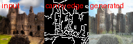
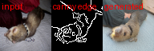
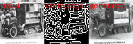
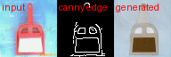
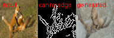

<div align="center">

# 🎨 Edge-ControlNet for Consistency Models

### 给一致性模型加上「二值边缘图控制生成」能力

**输入任意图片 → 提取 Canny 边缘 → 生成一张「结构服从边缘、纹理自由填充」的新图**
把 [ControlNet](https://arxiv.org/abs/2302.05543) 的空间控制思想，迁移到 [Consistency Models](https://arxiv.org/abs/2303.01469) 上 —— **单步即可出图**

<br>


</div>

---

## 📖 项目简介

本项目在 OpenAI《Consistency Models》(Song et al., 2023) 官方代码基础上，把图像生成模型从无条件 / 类别条件的 `f_θ(x_t, t)` 扩展为 **边缘图条件模型 `f_θ(x_t, t, c)`**。

> 给定一张二值边缘图 `c`（对图像跑 Canny 得到的黑白线稿），模型生成的图像在 **轮廓 / 结构 / 布局上服从 c**，同时自由填充真实的纹理与外观。

核心思路：**把 ControlNet 的训练期手段迁移到一致性模型** —— 冻结预训练主干，新增一个可训练的 ControlNet 旁路分支，用「零卷积」把边缘特征注入主干，再用 **条件一致性训练（CT）** 微调。这样模型既保留一致性模型「单步生成」的优势，又获得了精确的结构可控性。

---

## ✨ 工作亮点

| | 亮点 | 说明 |
|---|---|---|
| 🔗 | **ControlNet × Consistency Model** | 把 ControlNet 式空间控制接到一致性模型上，**单步 / 少步**即可生成服从边缘的图像 |
| ❄️ | **冻结主干 + 零卷积注入** | 仅训练旁路分支；零卷积初始化 → 训练起点 **完全等价于原模型**，稳定不退化 |
| 🧬 | **边界条件天然守住** | `c_out(ε)=0` 在架构上保证 `f(x, ε, c) = x` 恒成立，边缘条件 **不可能破坏** 一致性模型的边界条件 |
| 🎯 | **条件 CT 微调（无需教师）** | 在线模型与 EMA target 同吃一张边缘图，"同轨道 + 同条件 → 输出一致" 天然成立 |
| 🪶 | **零成本条件透传** | 边缘图经 `model_kwargs` 自动流经 训练 / CD / CT / 采样 全链路 |
| ✅ | **充分验证** | 17 项 CPU 正确性测试全通过 + 真实 ImageNet-64 上 4×A6000 训练跑通 |

---

## 🖼️ 效果展示

> 每张为三联图：**「 输入图 ｜ Canny 边缘 ｜ 生成图 」**。
> 可以看到 **生成图的结构紧跟边缘**（主体位置、轮廓、布局），纹理则由模型填充。

<div align="center">

| 🏰 建筑 | 🦦 动物 | 🚚 车辆 |
|:---:|:---:|:---:|
|  |  |  |
| 🖥️ 物体 | 🧸 玩具 | 🐟 其它 |
|  |  |  |

</div>

*更多示例见 [`examples/`](examples/)。模型在 ImageNet-64 上训练，输出为 64×64；演示重点是「结构可控性」。*

---

## 🧠 方法概览

```
   任意图片 ──[Canny]──► 边缘图 c ┐
                                  │
   噪声 x_t ───────────────────────┤──►  ControlledModel
                                  │        ├─ ControlNet(x_t, c, t, y):  可训练编码器副本 + 零卷积残差
   类别 y ─────────────────────────┘        └─ 冻结 UNet(x_t, t, y, + 残差):  解码器 skip += 残差
                                                         │
                                            f = c_skip(σ)·x_t + c_out(σ)·F   ──►  生成图
```

**三个关键设计（详见技术文档）：**

1. **条件如何进网络** —— `denoise()` 里 `model(c_in·x_t, t, **model_kwargs)`，边缘图塞进 `model_kwargs` 即可自动透传到全链路；边缘图不随噪声水平 `t` 变化，是跨所有 `t` 固定的结构约束。
2. **ControlNet 分支** —— `input_hint_block`（边缘编码器，末层零初始化）+ 主干编码器的可训练 deepcopy 副本 + 每个 skip 一个零卷积，把副本特征作为残差加回主干解码器。
3. **为什么用 CT 不用 CD** —— CD 的教师不认识边缘图（会报错）；CT 无教师，在线与 target 同条件，天然相容。

---

## 🚀 快速开始

**1. 环境**（国内镜像加速）
```bash
CN_MIRROR=1 bash scripts/setup_cm_env.sh && conda activate cm
```

**2. 下载主干 + 训练好的 ControlNet 权重**
```bash
bash scripts/download_checkpoints.sh checkpoints          # 冻结主干 (ImageNet-64 CM)
# 训练好的 ControlNet 权重 (ema_0.9999_040000.pt, 1.6GB) 见本仓库 Releases:
#   https://github.com/masktrump19-sudo/consistency_models_controlnet/releases
```

**3. 现场 Demo（网页版，拖图即测）**
```bash
python scripts/demo.py --use_controlnet True --gradio True --share True \
  --model_path <下载的 ema_0.9999_040000.pt>
```
> 拖入任意图片 → 填 ImageNet 类别 id（匹配内容，如狗=207、城堡=483）→ 选 "multi-step (quality)" → 出三联图。

**4. 训练（4 卡，从冻结主干微调 ControlNet）**
```bash
python scripts/prep_imagenet64.py --out_dir data/imagenet64 --n 100000   # 数据
mpiexec -n 4 python scripts/cm_train.py --training_mode consistency_training \
  --use_controlnet True --controlnet_init_checkpoint checkpoints/cd_imagenet64_lpips.pt \
  --data_dir data/imagenet64 --loss_norm lpips --use_fp16 True \
  --image_size 64 --num_channels 192 --num_res_blocks 3 --num_head_channels 64 \
  --attention_resolutions 32,16,8 --class_cond True --use_scale_shift_norm True --resblock_updown True \
  --target_ema_mode fixed --start_ema 0.95 --scale_mode fixed --start_scales 40 \
  --global_batch_size 128 --lr 1e-4 \
  --total_training_steps 100000 --lr_anneal_steps 100000 --save_interval 5000 --save_keep_last 3 --canny_random True
```
一键完整流程见 [`scripts/run_demo_pipeline.sh`](scripts/run_demo_pipeline.sh)。

---

## 📁 关键文件

```
cm/
 ├─ controlnet.py        ★ ControlNet 分支 + ControlledModel 包装（核心）
 ├─ unet.py              主干 UNet（接入 control 残差 + 注意力回退）
 ├─ karras_diffusion.py  c_skip/c_out、CD/CT 损失、采样器
 ├─ image_datasets.py    在线 Canny 边缘数据
 └─ edge_util.py         鲁棒图像加载 / Canny / 三联图可视化
scripts/
 ├─ demo.py            ★ 现场 Demo（CLI + Gradio 网页）
 ├─ cm_train.py          训练入口（检查点初始化 + 冻结主干）
 ├─ image_sample.py      边缘条件批量采样
 ├─ prep_imagenet64.py   下载 ImageNet-64 子集
 └─ eval_edge_fidelity.py  边缘服从度评测 (F1/IoU)
tests/smoke_controlnet.py  17 项 CPU 正确性测试
```

## 📚 技术文档

- 📘 [`阶段二_技术方案_ControlNet边缘控制.md`](阶段二_技术方案_ControlNet边缘控制.md) —— 设计因果链、逐文件改动、FAQ、面试问答预演
- 📗 [`阶段二_项目总结报告.md`](阶段二_项目总结报告.md) —— 完整总结、踩坑与修复、三种路线对比

## 📊 评测

- **边缘服从度**：对生成图重提 Canny，与输入边缘算 **F1 / dilated-IoU**（`scripts/eval_edge_fidelity.py`）
- **生成质量**：FID（`evaluations/`）
- **消融**：`edge=None` vs `edge=c`、不同 Canny 阈值

---

## 🙏 致谢

本项目基于 OpenAI 的 [consistency_models](https://github.com/openai/consistency_models)（MIT License）二次开发，ControlNet 思想来自 [Zhang et al., 2023](https://arxiv.org/abs/2302.05543)。

## 👤 作者

| | |
|---|---|
| **姓名** | 「请填写你的姓名」 |
| **学校** | 「请填写你的学校」 |
| **邮箱** | masktrump19@gmail.com |
| **GitHub** | [@masktrump19-sudo](https://github.com/masktrump19-sudo) |

## 📄 License

[MIT](LICENSE) © 2026
